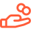
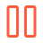
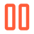

# Adapt To Life symbols

**Generated by `npm run icons` from `data/icons.mjs`. Do not edit by hand.** This is the current collection: every symbol the three sites use, one meaning, one picture. The rules for which library does what and which style means what are in [`brand/README.md`](../README.md#icons-and-symbols-current-since-2026-10-29). Open [`sheet.html`](sheet.html) to see every symbol at 18, 28 and 56px on both page colors.

Each file is a plain SVG drawn in the brand orange, with everything inside set to `currentColor`, so it recolors in Figma, Canva, a slide or a page. Styles: **regular** for chips and details, **duotone** for a section's symbol, **bold** for where you are, **fill** for selected.

Drawn from `@iconify-json/simple-icons@1.2.101`, `@iconify-json/material-symbols-light@1.2.98`, `@iconify-json/ph@1.2.2`. Phosphor and Hugeicons are MIT, Material Symbols is Apache 2.0, Simple Icons is CC0.

## The volunteer lanes

| Preview | Meaning | What it means | Drawn from | Files |
|---|---|---|---|---|
|     | `giving` | Giving and fundraising: money and support that reach athletes | Phosphor `hand-heart` | [regular](svg/giving.svg) · [duotone](svg/giving-duotone.svg) · [bold](svg/giving-bold.svg) · [fill](svg/giving-fill.svg) |
|     | `operations` | The books, insurance and legal work that protect athletes | Phosphor `shield-check` | [regular](svg/operations.svg) · [duotone](svg/operations-duotone.svg) · [bold](svg/operations-bold.svg) · [fill](svg/operations-fill.svg) |
|     | `stories` | Stories and reach: social, writing, photo, video, press | Phosphor `megaphone-simple` | [regular](svg/stories.svg) · [duotone](svg/stories-duotone.svg) · [bold](svg/stories-bold.svg) · [fill](svg/stories-fill.svg) |
|     | `participation` | Taking part in sport: coaching, events, equipment, mentoring | Phosphor `wheelchair-motion` | [regular](svg/participation.svg) · [duotone](svg/participation-duotone.svg) · [bold](svg/participation-bold.svg) · [fill](svg/participation-fill.svg) |
|     | `connections` | Connections: introductions, hosting, advising | Phosphor `handshake` | [regular](svg/connections.svg) · [duotone](svg/connections-duotone.svg) · [bold](svg/connections-bold.svg) · [fill](svg/connections-fill.svg) |

## Sport and place

| Preview | Meaning | What it means | Drawn from | Files |
|---|---|---|---|---|
|  | `pickleball` | Pickleball specifically | Material Symbols Light `pickleball-rounded` | [regular](svg/pickleball.svg) |
|     | `courts` | Courts and venues that host us | Phosphor `court-basketball` | [regular](svg/courts.svg) · [duotone](svg/courts-duotone.svg) · [bold](svg/courts-bold.svg) · [fill](svg/courts-fill.svg) |
|     | `community` | The organizations and people we play alongside | Phosphor `users-three` | [regular](svg/community.svg) · [duotone](svg/community-duotone.svg) · [bold](svg/community-bold.svg) · [fill](svg/community-fill.svg) |
|     | `cheering` | Support and conversation in the comments | Phosphor `chats-circle` | [regular](svg/cheering.svg) · [duotone](svg/cheering-duotone.svg) · [bold](svg/cheering-bold.svg) · [fill](svg/cheering-fill.svg) |
|     | `play` | Watch a video or reel | Phosphor `play-circle` | [regular](svg/play.svg) · [duotone](svg/play-duotone.svg) · [bold](svg/play-bold.svg) · [fill](svg/play-fill.svg) |
|     | `event` | A dated event or campaign | Phosphor `calendar-dots` | [regular](svg/event.svg) · [duotone](svg/event-duotone.svg) · [bold](svg/event-bold.svg) · [fill](svg/event-fill.svg) |
|     | `tournament` | Tournaments and results | Phosphor `trophy` | [regular](svg/tournament.svg) · [duotone](svg/tournament-duotone.svg) · [bold](svg/tournament-bold.svg) · [fill](svg/tournament-fill.svg) |

## How the fund spends

| Preview | Meaning | What it means | Drawn from | Files |
|---|---|---|---|---|
|     | `equipment` | Equipment: sport chairs, gear, repairs | Phosphor `toolbox` | [regular](svg/equipment.svg) · [duotone](svg/equipment-duotone.svg) · [bold](svg/equipment-bold.svg) · [fill](svg/equipment-fill.svg) |
|     | `training` | Training: practice, clinics, coaching time | Phosphor `target` | [regular](svg/training.svg) · [duotone](svg/training-duotone.svg) · [bold](svg/training-bold.svg) · [fill](svg/training-fill.svg) |
|     | `travel` | Travel: getting to the tournament or event | Phosphor `airplane-tilt` | [regular](svg/travel.svg) · [duotone](svg/travel-duotone.svg) · [bold](svg/travel-bold.svg) · [fill](svg/travel-fill.svg) |

## How a grant works

| Preview | Meaning | What it means | Drawn from | Files |
|---|---|---|---|---|
|     | `apply` | Send an application or a request | Phosphor `paper-plane-tilt` | [regular](svg/apply.svg) · [duotone](svg/apply-duotone.svg) · [bold](svg/apply-bold.svg) · [fill](svg/apply-fill.svg) |
|     | `review` | A person reads it | Phosphor `book-open-text` | [regular](svg/review.svg) · [duotone](svg/review-duotone.svg) · [bold](svg/review-bold.svg) · [fill](svg/review-fill.svg) |
|     | `decision` | A decision is weighed and made | Phosphor `scales` | [regular](svg/decision.svg) · [duotone](svg/decision-duotone.svg) · [bold](svg/decision-bold.svg) · [fill](svg/decision-fill.svg) |
|     | `funding` | Money paid to or for an athlete or the fund | Phosphor `hand-coins` | [regular](svg/funding.svg) · [duotone](svg/funding-duotone.svg) · [bold](svg/funding-bold.svg) · [fill](svg/funding-fill.svg) |

## Ways to give

| Preview | Meaning | What it means | Drawn from | Files |
|---|---|---|---|---|
|     | `recurring` | Something that repeats, like a monthly gift | Phosphor `arrows-clockwise` | [regular](svg/recurring.svg) · [duotone](svg/recurring-duotone.svg) · [bold](svg/recurring-bold.svg) · [fill](svg/recurring-fill.svg) |
|     | `business` | A business or employer | Phosphor `buildings` | [regular](svg/business.svg) · [duotone](svg/business-duotone.svg) · [bold](svg/business-bold.svg) · [fill](svg/business-fill.svg) |
|     | `tribute` | In honor or in memory of someone | Phosphor `flower-lotus` | [regular](svg/tribute.svg) · [duotone](svg/tribute-duotone.svg) · [bold](svg/tribute-bold.svg) · [fill](svg/tribute-fill.svg) |
|     | `investments` | Stock, donor-advised funds, other assets | Phosphor `chart-line-up` | [regular](svg/investments.svg) · [duotone](svg/investments-duotone.svg) · [bold](svg/investments-bold.svg) · [fill](svg/investments-fill.svg) |
|     | `secure` | Secure: checkout, data, privacy | Phosphor `lock-key` | [regular](svg/secure.svg) · [duotone](svg/secure-duotone.svg) · [bold](svg/secure-bold.svg) · [fill](svg/secure-fill.svg) |
|     | `receipt` | A receipt or tax record | Phosphor `receipt` | [regular](svg/receipt.svg) · [duotone](svg/receipt-duotone.svg) · [bold](svg/receipt-bold.svg) · [fill](svg/receipt-fill.svg) |

## Fundraisers and roles

| Preview | Meaning | What it means | Drawn from | Files |
|---|---|---|---|---|
|     | `store` | A store opens, ours or a partner's | Phosphor `storefront` | [regular](svg/store.svg) · [duotone](svg/store-duotone.svg) · [bold](svg/store-bold.svg) · [fill](svg/store-fill.svg) |
|     | `order` | Place an order | Phosphor `shopping-bag-open` | [regular](svg/order.svg) · [duotone](svg/order-duotone.svg) · [bold](svg/order-bold.svg) · [fill](svg/order-fill.svg) |
|     | `coaching` | Coaching and building a program | Phosphor `chalkboard-teacher` | [regular](svg/coaching.svg) · [duotone](svg/coaching-duotone.svg) · [bold](svg/coaching-bold.svg) · [fill](svg/coaching-fill.svg) |
|     | `scope` | A defined scope of work | Phosphor `list-checks` | [regular](svg/scope.svg) · [duotone](svg/scope-duotone.svg) · [bold](svg/scope-bold.svg) · [fill](svg/scope-fill.svg) |
|     | `reply` | We reply; you hear back | Phosphor `envelope-simple` | [regular](svg/reply.svg) · [duotone](svg/reply-duotone.svg) · [bold](svg/reply-bold.svg) · [fill](svg/reply-fill.svg) |
|     | `search` | Search or look something up | Phosphor `magnifying-glass` | [regular](svg/search.svg) · [duotone](svg/search-duotone.svg) · [bold](svg/search-bold.svg) · [fill](svg/search-fill.svg) |
|     | `open` | Open to everyone: no account, no fee | Phosphor `lock-simple-open` | [regular](svg/open.svg) · [duotone](svg/open-duotone.svg) · [bold](svg/open-bold.svg) · [fill](svg/open-fill.svg) |

## Where work stands

| Preview | Meaning | What it means | Drawn from | Files |
|---|---|---|---|---|
|     | `live` | Live today: done and available | Phosphor `check-circle` | [regular](svg/live.svg) · [duotone](svg/live-duotone.svg) · [bold](svg/live-bold.svg) · [fill](svg/live-fill.svg) |
|     | `building` | Being built or strengthened now | Phosphor `hammer` | [regular](svg/building.svg) · [duotone](svg/building-duotone.svg) · [bold](svg/building-bold.svg) · [fill](svg/building-fill.svg) |
|     | `later` | Where we are headed next | Phosphor `compass` | [regular](svg/later.svg) · [duotone](svg/later-duotone.svg) · [bold](svg/later-bold.svg) · [fill](svg/later-fill.svg) |

## Details, navigation and controls

| Preview | Meaning | What it means | Drawn from | Files |
|---|---|---|---|---|
|     | `time` | How much time something takes | Phosphor `clock` | [regular](svg/time.svg) · [duotone](svg/time-duotone.svg) · [bold](svg/time-bold.svg) · [fill](svg/time-fill.svg) |
|     | `place` | A city or venue | Phosphor `map-pin` | [regular](svg/place.svg) · [duotone](svg/place-duotone.svg) · [bold](svg/place-bold.svg) · [fill](svg/place-fill.svg) |
|     | `arrow` | Go to a page on this site | Phosphor `arrow-right` | [regular](svg/arrow.svg) · [duotone](svg/arrow-duotone.svg) · [bold](svg/arrow-bold.svg) · [fill](svg/arrow-fill.svg) |
|     | `external` | Opens another site | Phosphor `arrow-up-right` | [regular](svg/external.svg) · [duotone](svg/external-duotone.svg) · [bold](svg/external-bold.svg) · [fill](svg/external-fill.svg) |
|     | `back` | Back to the list this page belongs to | Phosphor `arrow-left` | [regular](svg/back.svg) · [duotone](svg/back-duotone.svg) · [bold](svg/back-bold.svg) · [fill](svg/back-fill.svg) |
|     | `caret` | Opens a menu | Phosphor `caret-down` | [regular](svg/caret.svg) · [duotone](svg/caret-duotone.svg) · [bold](svg/caret-bold.svg) · [fill](svg/caret-fill.svg) |
|     | `check` | Yes: included, you qualify, it applies | Phosphor `check` | [regular](svg/check.svg) · [duotone](svg/check-duotone.svg) · [bold](svg/check-bold.svg) · [fill](svg/check-fill.svg) |
|     | `more` | Show more (turns to a close mark when open) | Phosphor `plus` | [regular](svg/more.svg) · [duotone](svg/more-duotone.svg) · [bold](svg/more-bold.svg) · [fill](svg/more-fill.svg) |
|     | `close` | Close this sheet or dialog | Phosphor `x` | [regular](svg/close.svg) · [duotone](svg/close-duotone.svg) · [bold](svg/close-bold.svg) · [fill](svg/close-fill.svg) |
|     | `pause` | Pause moving pictures | Phosphor `pause` | [regular](svg/pause.svg) · [duotone](svg/pause-duotone.svg) · [bold](svg/pause-bold.svg) · [fill](svg/pause-fill.svg) |
|     | `resume` | Resume moving pictures (not a video: that is play) | Phosphor `play` | [regular](svg/resume.svg) · [duotone](svg/resume-duotone.svg) · [bold](svg/resume-bold.svg) · [fill](svg/resume-fill.svg) |

## Logos

Logos mean a tool or platform, never a concept.

| Preview | Name | What it is | File |
|---|---|---|---|
|  | `instagram` | Instagram | [instagram.svg](logos/instagram.svg) |
|  | `facebook` | Facebook | [facebook.svg](logos/facebook.svg) |
|  | `buffer` | Buffer | [buffer.svg](logos/buffer.svg) |
|  | `google` | Google Workspace | [google.svg](logos/google.svg) |
|  | `apple` | Apple Calendar (add to calendar) | [apple.svg](logos/apple.svg) |
|  | `googlecalendar` | Google Calendar (add to calendar) | [googlecalendar.svg](logos/googlecalendar.svg) |
|  | `outlook` | Outlook (add to calendar) | [outlook.svg](logos/outlook.svg) |

## Retired

Kept, labeled and not used. See [`brand/README.md`](../README.md#retired-never-use).

- [Custom icon set and reel covers, October 2026](../obsolete/icons-2026-10-custom/README.md)
- 3D sport icons and unused badge PNGs: `archive/icons/` in adapttolife/adaptivesportsnearme (map: `docs/ICONS-AND-LOGOS.md`)
