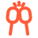
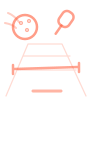
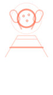
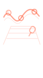
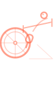
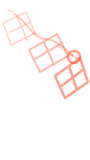
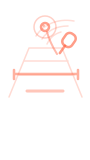

# Retired: custom icon set and reel covers (October 2026)

**Status: retired 2026-10-29. Kept, not deleted, so it can come back. Do not use it for new work.** The current icons are the symbol dictionary in `data/icons.mjs`; see "Icons and symbols" in `brand/README.md`.

## What it is

Thirteen line icons and six reel covers, drawn on 2026-10-29 for `/volunteer` and `/social` (PR #206). They came from three rounds between Codex and Claude, built from adaptive-sport geometry: the handrim and spoked wheel, the court from above, the paddle and the perforated ball, and the paddle tap at the net.

| File | What it holds |
|---|---|
| `icons.mjs` | The thirteen icons as SVG inner markup (24-unit grid, 2px round stroke, `currentColor`), with a note on where each came from. This is the file that was `scripts/lib/icons.mjs` while the set was live. |
| `reel-covers.json` | The six line-art reel covers (viewBox 0 0 90 160), one per reel on `/social`. |
| `sheet.html` | Open this to see the whole set at 18, 28 and 56px on both page colors, plus the covers. |
| `svg/` | Each retired icon and cover as its own SVG file, previewed below. |

## The set

| Preview | Name | File |
|---|---|---|
|  | `fund` | [svg/fund.svg](svg/fund.svg) |
|  | `operations` | [svg/operations.svg](svg/operations.svg) |
|  | `stories` | [svg/stories.svg](svg/stories.svg) |
|  | `participation` | [svg/participation.svg](svg/participation.svg) |
|  | `connections` | [svg/connections.svg](svg/connections.svg) |
|  | `courts` | [svg/courts.svg](svg/courts.svg) |
|  | `community` | [svg/community.svg](svg/community.svg) |
|  | `cheering` | [svg/cheering.svg](svg/cheering.svg) |
|  | `play` | [svg/play.svg](svg/play.svg) |
|  | `external` | [svg/external.svg](svg/external.svg) |
|  | `time` | [svg/time.svg](svg/time.svg) |
|  | `place` | [svg/place.svg](svg/place.svg) |
|  | `arrow` | [svg/arrow.svg](svg/arrow.svg) |

Reel covers, in reel order (Monster Smash, Cincinnati, Meet the mascot, Bad Bunny on repeat, Pickleball on wheels, We'll play anywhere, Court time):

     

## Why it was retired

Alec, 2026-10-29: "I think they all look horrible." At 18px in the volunteer jump bar the drawings closed up into blobs, three lane icons shared the same paddle silhouette, and the pieces from two hands never matched each other. A tested open-source library does that job better, so the site now draws from Phosphor, Material Symbols Light, Hugeicons and Simple Icons through one dictionary.

## Bringing it back

Copy `icons.mjs` to `scripts/lib/`, or lift single drawings from it into `data/icons.mjs` as a new source. The paddle tap (`connections`) and the spoked wheel (`community`) are the two worth another look.
